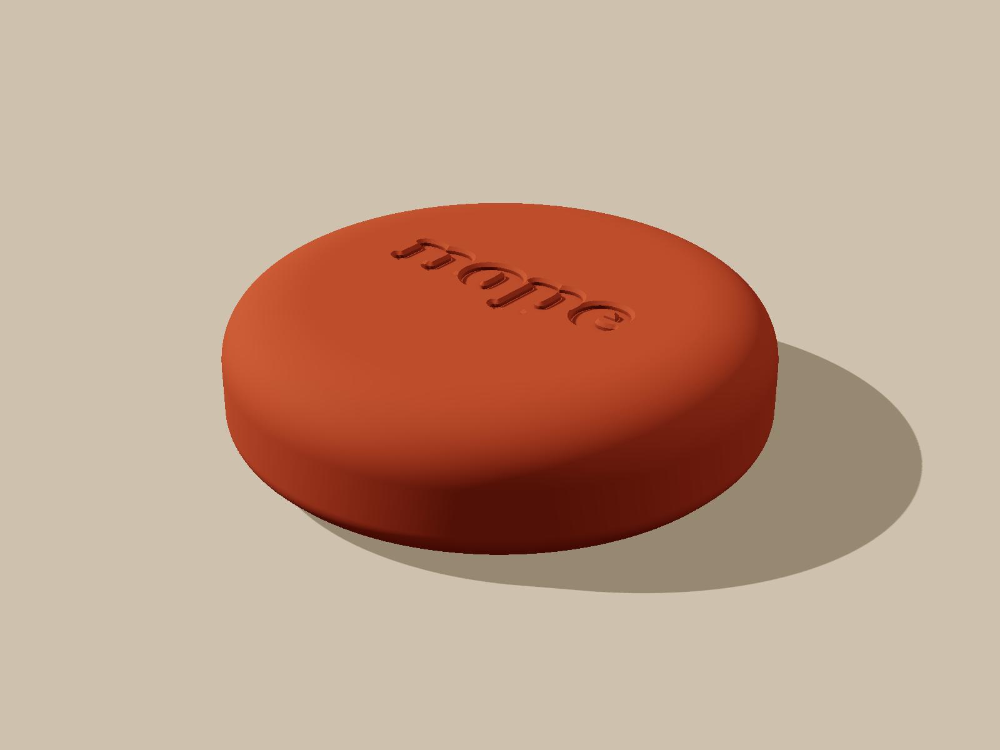

# nope: physical product

v1.0 "pebble". A 64 x 16 mm matte puck with a wide pillow roll, "nope" debossed in the middle, a hidden 25 mm NTAG213 tag and a coin-twist base cap. Designed to match panel 2 of the brand board and to print on any FDM printer today, with a path to casting and injection molding.



## Index

| File | What it is |
|---|---|
| `case/build_case.py` | Parametric generator. Every dimension is a named parameter at the top. `python3 build_case.py` rebuilds all STLs and `build_report.txt`. `--svg logo.svg` swaps in the real lettering, `--sticker 18` rebuilds for an 18 mm tag |
| `case/nope_body.stl` | The puck (print this) |
| `case/nope_base_cap.stl` | Bayonet base cap with sticker post (print this) |
| `case/nope_assembled.stl` | Preview only: body + locked cap + sticker + foam as separate shells |
| `case/nope_nest.stl` | Optional wall or desk cradle, no magnets |
| `case/nfc_test_coupons.stl` | 1.0 / 1.6 / 2.2 / 3.0 / 4.0 mm coupons for the NFC test (128 x 84 mm grid) |
| `case/legacy/nope_puck_v0.2_60x12.stl` | The old simple puck (v0.2), kept for the sample order baseline |
| `case/build_report.txt` | Generated numbers: sizes, volumes, masses, wall and overhang checks |
| `case/fonts/` | Corben Bold (SIL OFL), placeholder for the brand lettering |
| `case/reference/` | Sticker, foam, section and locked-cap parts used by the renders |
| `renders/` | 7 renders + `nope_vs_brand_photo.png`; `renders/tools/` regenerates them (three.js in headless Chromium) |
| `NFC_ENGINEERING.md` | How the read works through the shell, test plan, default |
| `PRD.md` | Problem, users, P0/P1/P2 requirements, metrics, acceptance |
| `BOM_AND_COSTS.md` | BOM and landed cost at 50 / 500 / 5,000 with formulas |
| `MANUFACTURING_ROADMAP.md` | FDM, then casting, then molding: triggers, costs, how to get quotes |
| `PACKAGING.md` | Box, insert, quick start card, backup code card, gift, spare |
| `RISKS_AND_QC.md` | Failure modes and the per-unit QC checklist |
| `../case/nope_puck_60mm.stl` | Old link, now an exact copy of `nope_body.stl` |

## Design in one paragraph

64 mm across (a palm, not a coaster, per Karan's "make it small"), 16 mm tall: height to width 0.25, read from the brand photo, where the puck is a fat coin with a clearly visible soft side. The top edge is a 10 x 7.5 mm superellipse roll so the top flows into the side the way the photo's pillow edge does; the flat top is 44 mm across and stays flat because a shallow dome prints as contour rings on FDM. The bottom edge is rounded but limited to 45 degrees so it prints without supports. "nope" is 32 mm wide (half the diameter, as in the photo), centred, 0.8 mm deep with a 0.4 mm soft chamfer. Under the logo sits the 25 mm tag behind 2.4 mm of plastic, pressed flat by a foam disc so it never rattles even if the adhesive fails. The underside closes with a quarter-turn bayonet cap: 3 lugs, a wedge ramp that tolerates printer variation, a coin slot, open and locked marks, three silicone feet, and "put it down." in small letters. If the bayonet ever fails, a 58 mm felt pad closes the underside instead.

## How close it is to the brand photo

See `renders/nope_vs_brand_photo.png`. Honest read:
- **Matches:** round pebble silhouette, proportion (fat coin, visible soft side), pillow top edge, flat matte top, centred lowercase wordmark at about half the diameter, debossed not printed, no visible seams or holes from above.
- **Differs:** (1) the photo's lettering is a heavier, simpler, almost sans form; ours uses Corben Bold, a free font close to the board's logo, until the brand designer supplies an SVG. (2) The photo is an AI image with a soft, slightly rubbery look and leather-like texture; PETG FDM will show fine layer lines on the roll and a less velvety top. Expect about 70 to 80 % of the photo's feel on FDM and 95 % when molded with texture. (3) The photo's puck may be a little thinner (I read H/D between 0.22 and 0.28; we chose 0.25 to keep weight and room for the tag). (4) Render colours are approximate.

## Send this to the printer (order sheet)

### Order A: samples, now (per ceo/DECISION_LOG.md D12)

| Line | File | Qty | Orientation on the bed | Why |
|---|---|---|---|---|
| 1 | `case/nope_body.stl` | 2 | Top face UP, flat underside on the bed | The pillow roll only prints cleanly growing upward; the flat top gets ironed; underside is flat for adhesion |
| 2 | `case/nope_base_cap.stl` | 3 | Outer face DOWN (coin slot on the bed) | Post grows upward with no supports; the visible face is the smooth bed face. One extra because the bayonet fit is the likeliest failure |
| 3 | `case/nfc_test_coupons.stl` | 1 set | Flat as exported (128 x 84 mm, fits any bed) | Must be the same filament as the bodies |
| 4 | `case/legacy/nope_puck_v0.2_60x12.stl` | 2 | Bottom face down | Cheap baseline and fallback |

Cost cap Rs 1,500 including shipping, one shipment (D12). If over, cut in D12's order.

### Order B: pilot of 50, only after G1 passes and samples fit

50 x body, 52 x cap (2 spare), same settings, same filament lot. Optional: 5 x `nope_nest.stl` in a second colour (do not sell in the pilot, use for photos and feedback).

### Settings for every line

| Setting | Value |
|---|---|
| Material | PETG, plain matte, no silk, metallic, glitter or carbon fill (these can interfere with NFC) |
| Colour | Plain orange: choose the darkest, most muted orange stocked (closest to the brand board's terracotta #C65D3B; the CEO log calls the locked colour saffron/orange). Same lot for every part. Ask for a swatch photo first |
| Layer height | 0.12 to 0.16 mm for the body (or 0.2 mm with variable layer height on the roll); 0.2 mm for caps, coupons, nest |
| Walls | 4 perimeters |
| Top / bottom layers | 6 / 5 |
| Infill | 30 % gyroid (50 % if the vendor price difference is small: heavier feels better). Coupons: 100 % |
| Top surface | Ironing ON for the body if offered |
| Seam | Aligned, rear |
| Supports | NONE on any part. Bridges: the body has one 25.9 mm internal bridge above the sticker, hidden inside; enable normal bridging |
| Brim | None (the 45-degree bottom edge hides elephant foot) |
| Scale | 100 %, do not hollow, do not "repair" |

### Inspect on arrival

1. Body sits flat, no rocking; diameter 64.0 mm and height 16.0 mm within plus or minus 0.3 mm.
2. Letters fully open, especially the counters of "o", "p", "e".
3. No strings, zits or support marks on the top face; roll smooth to the touch.
4. Cap drops in at the dot and twists to the bar with firm, even resistance; opens with a coin.
5. Coupons measure 1.0 / 1.6 / 2.2 / 3.0 / 4.0 mm within plus or minus 0.1 mm (calipers).
6. Weigh one body and one cap, write down the grams (expected about 24 to 29 g and 8 to 9 g, **unverified**).
7. Colour of all parts matches; photo in daylight next to the brand board printout.

If the cap is too tight: sand the lug tops lightly, or rebuild with `LOCK_INTERFERENCE = 0.0`. Too loose: `LOCK_INTERFERENCE = 0.2`. Wrong radius: change `CAP_RAD_CLEARANCE` by 0.05 mm steps.

## Decisions I need from the founder (ranked)

1. **Colour name and physical target.** The brand board shows terracotta #C65D3B; the CEO decision log records a locked palette of "charcoal and saffron" and orders plain orange for the samples. *Recommendation:* samples in plain matte orange as ordered; for the pilot, pick the most muted, earthy orange swatch available and approve it against panel 2 in daylight. Decide one name for all docs. I did not rename "terracotta" across these docs because that conflicts with the brief I was given; tell me which wins and I will align everything in one pass.
2. **Size: 64 x 16 mm.** *Recommendation:* approve. Smaller (60 x 15) is possible in one parameter, but the photo reads as a substantial object and Neha's "should look like a proper object" points the same way.
3. **Bayonet cap vs felt pad for the pilot.** *Recommendation:* bayonet if 2 of 3 sample caps pass the fit test; else ship the pilot with the felt pad and fix the cap for unit 51+.
4. **Sticker size.** *Recommendation:* 25 mm. 18 mm only as a cost-down after the G1 data.
5. **Real lettering.** *Recommendation:* get an outlined SVG of the brand wordmark by Fri 13 Nov so the pilot uses it; samples use Corben Bold. Minimum stroke and gap 0.8 mm at 32 mm wide.
6. **Lock tags after writing.** *Recommendation:* yes for the pilot 50, after the app's UID pairing is confirmed; keep dev units unlocked.
7. **Spare puck and two-pack.** *Recommendation:* offer a spare puck and a "desk + bag" two-pack from the pilot; prices are the CEO and CFO's call, BOM_AND_COSTS.md shows a spare costs about Rs 160 to 260 to make at 50 units [A].
8. **Nest accessory.** *Recommendation:* print 2 for photos and feedback, do not sell until 500 units.

## Regenerate everything

```bash
cd product/case && python3 build_case.py                 # STLs + build_report.txt
NODE_PATH=$(npm root -g) node product/renders/tools/render.mjs   # renders (needs unpkg.com)
python3 product/renders/tools/compare.py <brand_board.webp>      # comparison image
```
